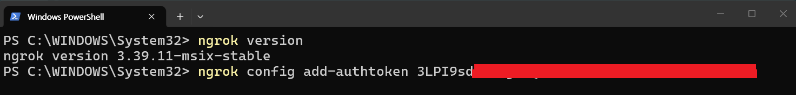
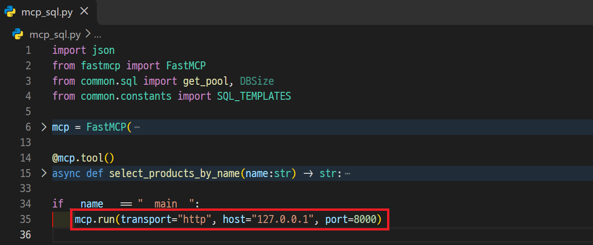
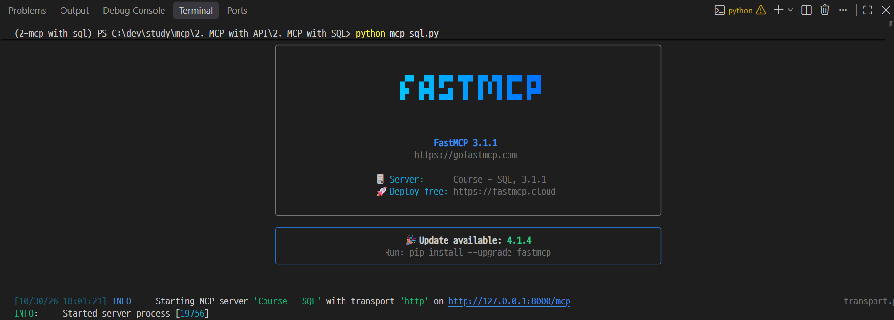
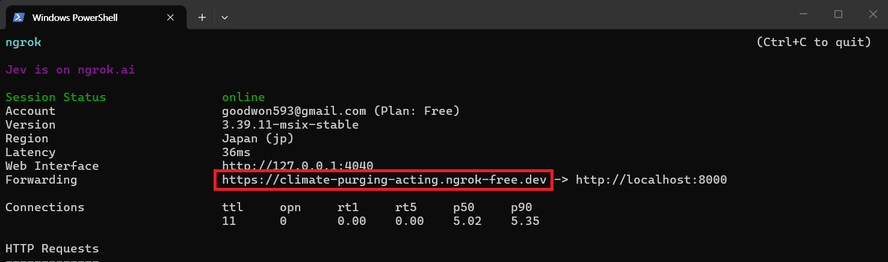
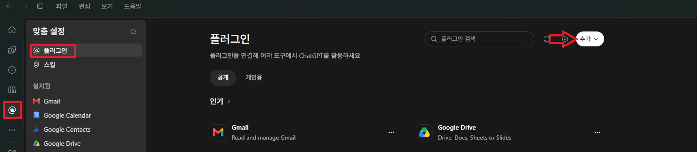
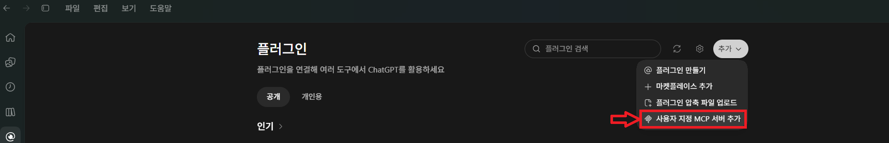
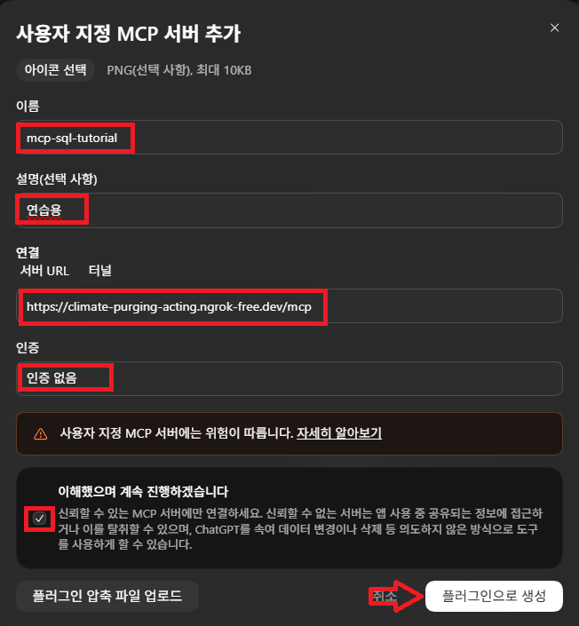
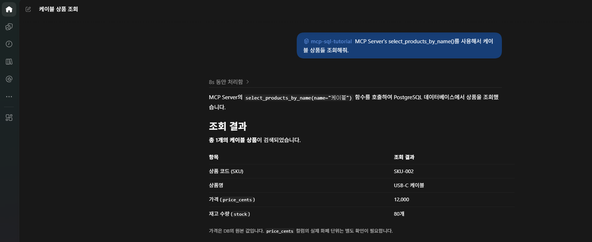

# ngrok이란?
> ngrok은 내 컴퓨터에서 실행 중인 서버를 외부에서 접속할 수 있도록 공개 주소를 만들어 주는 도구입니다. 이 연결 통로를 **터널(Tunnel)** 이라고 합니다.

예를 들어 내 PC의 http://localhost:8000에 연결되는 https://example.ngrok-free.app 같은 주소를 제공합니다. 실제 주소는 계정과 실행 설정에 따라 다릅니다.

| 용어 | 의미 |
| --- | --- |
| localhost / 127.0.0.1 | 요청을 실행하는 컴퓨터 자신 |
| 포트 8000 | 해당 컴퓨터에서 서버가 요청을 받는 번호 |
| 터널 | 외부 요청을 내 로컬 서버로 전달하는 통로 |
| /mcp | 서버가 MCP 요청을 처리하는 경로 |

---
## [ngrok 설치](https://ngrok.com/download/windows?utm_source=chatgpt.com)

1. PowerShell을 열고 설치하세요.
```powershell
winget install ngrok -s msstore
```
> 설치 후 PowerShell을 닫았다가 다시 열고 확인합니다.
```powershell
ngrok version
```
2. (최초 한 번)[ngrok 계정](https://dashboard.ngrok.com/get-started/gateway)을 만들고 [인증 토큰](https://dashboard.ngrok.com/get-started/your-authtoken)을 등록하세요.
```powershell
ngrok config add-authtoken "여기에_인증토큰"
```


---
## ngrok 비용 

| 항목 | Free | Hobbyist | Pay-as-you-go |
|---|---|---|---|
| 기본 요금 | **무료** | **월 $10** | **월 $20 + 추가 사용료** |
| 동시 온라인 엔드포인트 | 최대 3개 | 최대 3개 | 개수 제한 없음 |
| 포함 데이터 전송량 | 1GB | 5GB | 5GB |
| 포함 HTTP/S 요청 | 월 2만 회 | 월 10만 회 | 월 10만 회 |
| 사용 크레딧 | 최초 1회 $5 | 매월 $10 | 매월 $20 |
| 크레딧 초과 과금 | 없음 | 없음, 소진 시 중단 | 추가 사용량 청구 |

---
# 로컬 PC 실습

---
### 단계1: MCP Server 코드 확인 
>  mcp.run()실행시 http 통신으로 설정



---
### 단계2: MCP Server 실행 
> 정상적으로 MCP Server가 실행되어야 함!



---
### 단계3: ngrok http 실행
> MCP 서버가 사용하는 8000번 포트에 연결하세요.  
> 생성된 URL은 MCP 추가할 때, 사용할 예정이에요.
```powershell
ngrok http 8000
```


---
### 단계4: ChatGTP > 플러그인 > MCP 추가  




---
- 이름: 테스트 실행시 식별할 MCP 이름
- 서버 URL: `ngrok http 실행시 생성된 URL/mcp`



---
### 단계5: 테스트 및 결과 확인 
> `@MCP 이름` 요청 내용 작성



---
# 그 외 사용방법들 

---
## 종료하고 다시 사용하기

| 상황 | 실행 방법 |
| --- | --- |
| 최초 준비 | ngrok 설치 → 가입·인증 → 토큰 등록 |
| 매번 사용 | 터미널 A에서 MCP 서버 실행 → 터미널 B에서 ngrok 실행 |
| 사용 종료 | 각 터미널에서 Ctrl+C |
| 다음 실습 | 서버와 ngrok 재실행 → 공개 주소 확인 → 변경되었다면 ChatGPT URL 수정 |

---
## 여러 MCP 서버를 사용할 때
> 같은 PC에서 별도 서버를 동시에 실행한다면 서로 다른 포트를 사용합니다.

| 서버 예시 | 로컬 포트 | ngrok 명령어 |
| --- | --- | --- |
| 상품 조회 MCP | 8000 | `ngrok http 8000` |
| 날씨 조회 MCP | 8001 | `ngrok http 8001` |

